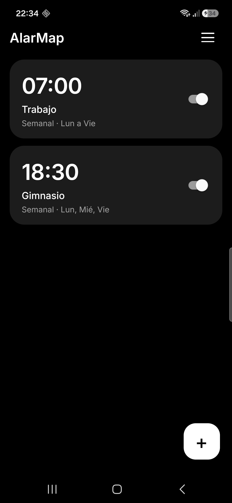
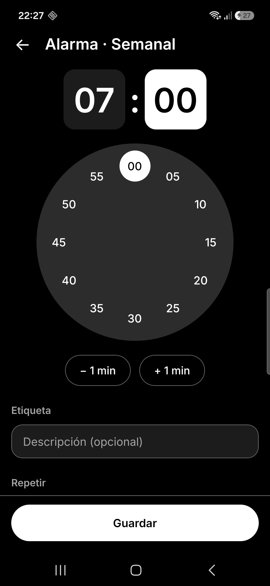
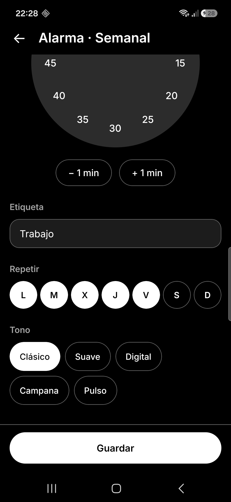
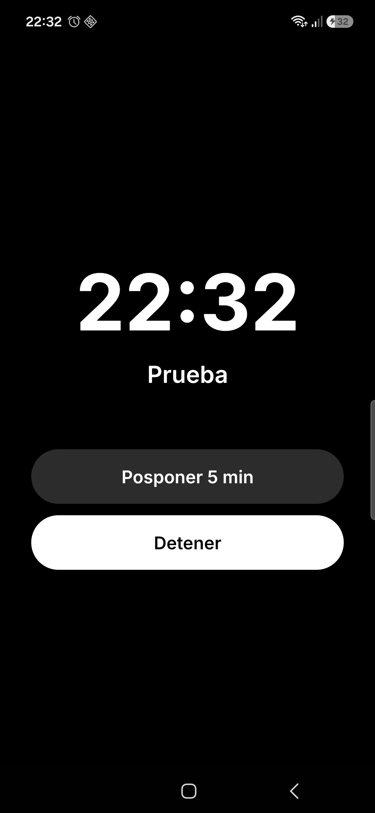
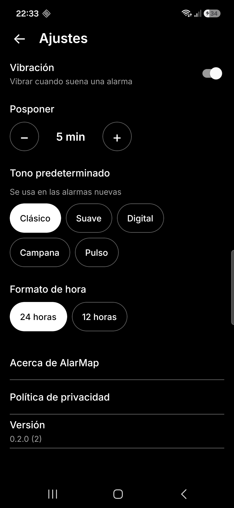

# AlarMap

Alarmas simples, locales y sin cuentas para Android.

[](https://github.com/moranfacundo/alarmap/actions/workflows/ci.yml)
[](LICENSE)

## Quiénes lo hacen

Hola, mi nombre es **Facundo Morán**, desarrollador web. AlarMap es mi app de alarmas: sin cuentas, sin publicidad,
sin telemetría y con todos los datos guardados solo en tu teléfono.

La desarrollo junto a **Claude** (de [Anthropic](https://www.anthropic.com)), mi coautor: un asistente de IA
que programa conmigo. Las decisiones del producto y la revisión del código son mías.

[GitHub](https://github.com/moranfacundo) · [LinkedIn](https://www.linkedin.com/in/moranfacundo/) · [Sitio web](https://facundo-moran.dev/)

## Estado

Versión `0.2.0`. Crear, editar y eliminar alarmas de una vez, semanales y mensuales; motor nativo en Kotlin
(`AlarmManager`) con pantalla de alarma sobre el bloqueo, Posponer y Detener; cinco tonos propios; ajustes;
y tema claro u oscuro según el sistema. La publicación en Google Play está en pausa: por ahora se compila desde este repo.

Tecnología: [Angular Native](https://ng-native.com) sobre Expo, TypeScript, Kotlin (Expo Modules) y SQLite.

## Capturas

<p>
  
  
  
  
  
</p>

## Requisitos

- Node.js 22.13 o superior (se usa 24) y npm
- JDK 17
- Android SDK con la plataforma 36 y build-tools 36
- Un teléfono o emulador con Android 14 o superior, con la depuración activada

## Levantarlo en local

```sh
git clone https://github.com/moranfacundo/alarmap.git
cd alarmap
npm ci

# Variables de entorno (ajusta las rutas a tu equipo)
export JAVA_HOME=/ruta/al/jdk-17
export ANDROID_HOME=$HOME/Android/Sdk

# Genera el proyecto nativo y compila la versión de desarrollo (la primera vez tarda varios minutos)
npx expo prebuild --platform android
cd android && ./gradlew :app:assembleDebug && cd ..

# Instálala en el dispositivo conectado (USB o Wi-Fi) y deja que llegue a Metro
adb install -r android/app/build/outputs/apk/debug/app-debug.apk
adb reverse tcp:8081 tcp:8081
npm start
```

Abre la app **AlarMap** en el teléfono. Como usa un módulo nativo propio, hace falta esta compilación:
Expo Go muestra la interfaz, pero no el módulo Kotlin.

## Probarlo

```sh
npm run typecheck   # tipos TypeScript y plantillas de Angular
npm test            # pruebas en Node, sin emulador
```

Para comprobar el enlace con Kotlin, usa la compilación de desarrollo en un dispositivo.

## Contribuir

¡Gracias por querer ayudar! Lee [CONTRIBUTING.md](CONTRIBUTING.md): explica las ramas, los commits en
español, los Pull Requests y cómo se publican las versiones. Para ideas o errores, abre un
[issue](https://github.com/moranfacundo/alarmap/issues/new/choose).

## Licencia

[MIT](LICENSE). La tipografía [Inter](https://rsms.me/inter/) se distribuye bajo la licencia OFL
(`assets/fonts/OFL-Inter-LICENSE.txt`).
